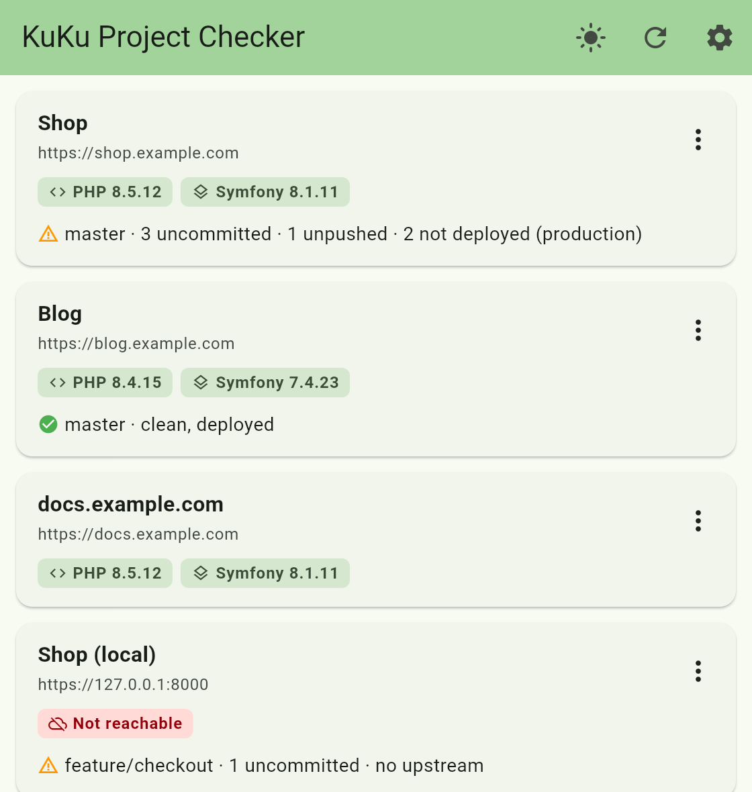

# KuKu Project Checker

[](https://github.com/elkuku/KuKuProjectChecker/actions/workflows/dart.yml)

Your Symfony sites at a glance: the PHP and Symfony versions of every site, and what is not yet
committed, pushed or deployed in its local repository. Shows the uncommitted changes with their
diffs, and opens a project in the browser, the file manager, a terminal, PhpStorm or VS Code.



**Documentation:** https://elkuku.github.io/KuKuProjectChecker/

## Quick start

```bash
flutter build linux --release
linux/packaging/install-desktop-entry.sh
```

Made with Dart and Flutter.
