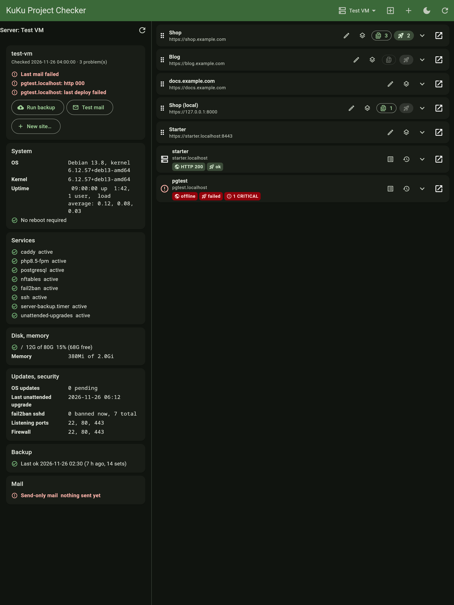
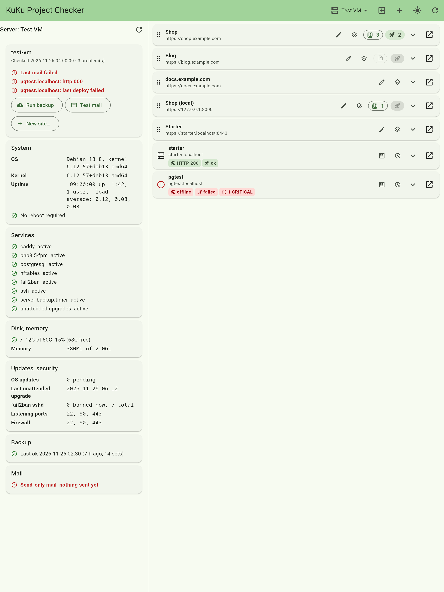

# Development guide

## Run and test

```bash
flutter run -d linux
flutter test
flutter analyze
```

The tests that check the repository status and the changes create throwaway git repositories,
so they need `git`.

## Code overview

| Folder | |
|---|---|
| `lib/main.dart` | The app, the project list (including temporary server-only sites) and the theme. |
| `lib/screens/` | The uncommitted changes and the diff, and the server status panel (beside the project list when a KMyServer is selected). |
| `lib/widgets/` | The compact project rows, server-only site rows, their action buttons and **Open in…** dropdown, the environments/new-site/deploy dialogs and the repository status line. |
| `lib/support/app_services.dart` | Everything the app reads from outside: settings, sites, repositories, installed apps, server health. Tests and the screenshots replace it with sample data. |
| `lib/support/server.dart` | A server: its git remote, SSH host and port, and the domain suffix suggested for new sites; saved in preferences.json. |
| `lib/support/site.dart` | A project and its named environments (`SiteTarget`: address, server, deploy remote). |
| `lib/support/server_api.dart` | Runs the installed `server-health --json` over SSH, with a fixed command. |
| `lib/support/server_health.dart` | The typed v1 health report; flattens its warnings for the status page. |
| `lib/support/site_creator.dart` | New site from a template: site-add over SSH, clone, GitHub repo. |
| `lib/support/kmyserver.dart` | Recognizes KMyServer site remotes; the ssh arguments for `site-deploy` (rollback). |
| `lib/support/repo_status.dart` | Branch, uncommitted, unpushed and undeployed counts, from local git data only. |
| `lib/support/repo_changes.dart` | The uncommitted files and their diffs. |
| `lib/support/open_in.dart` | The apps of the Open in … menu. |
| `linux/packaging/` | The icon and the menu entry installer. |

## Documentation

The documentation is built with [VitePress](https://vitepress.dev/):

```bash
npm install
npm run docs:dev      # http://localhost:5173/KuKuProjectChecker/
npm run docs:build
```

### Screenshots

The screenshots are rendered by a Flutter test from sample data, with real fonts, in both themes
(`…-dark.png` and `…-light.png`). The pages show the one matching the reader's theme; use both in
Markdown like this:

```md
{.theme-dark}
{.theme-light}
```

To regenerate them:

```bash
flutter test --update-goldens docs/screenshots/screenshots_test.dart
```

Run it after changing the app's look, and commit the new images. It needs the Noto Sans Mono or
DejaVu Sans Mono font for the diff. The script is not part of `flutter test`.
