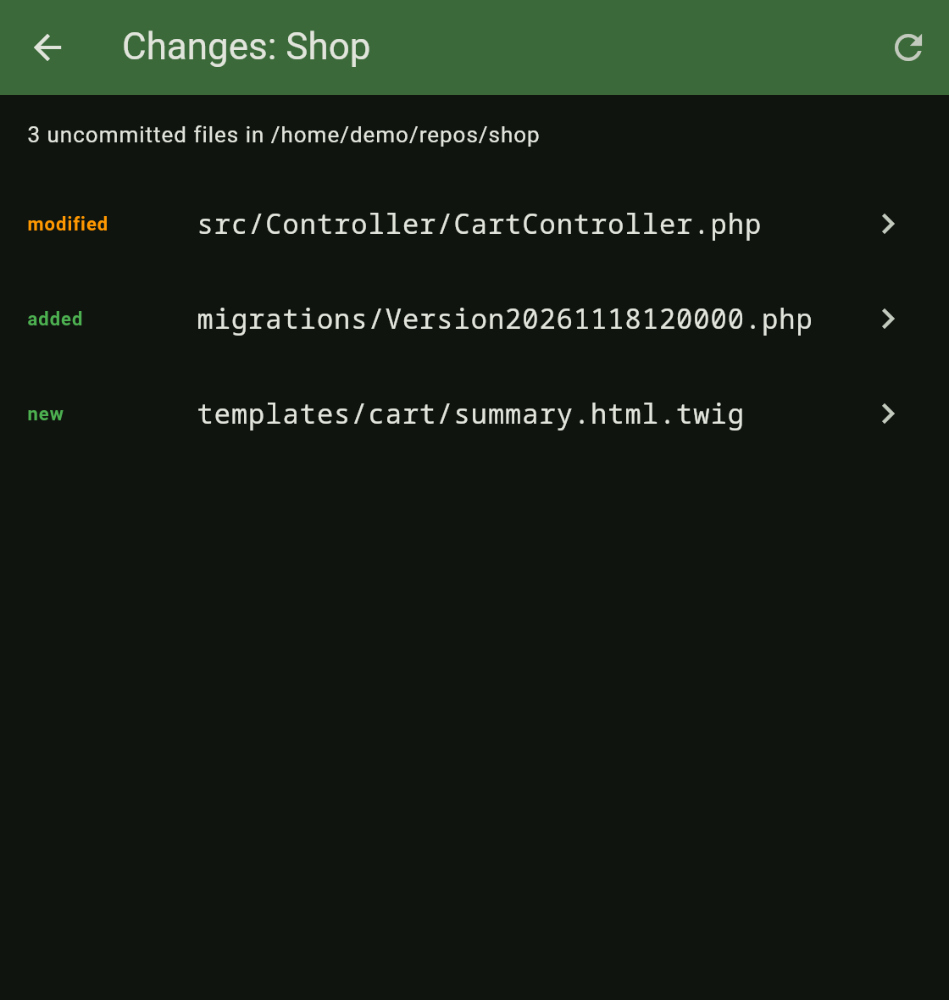
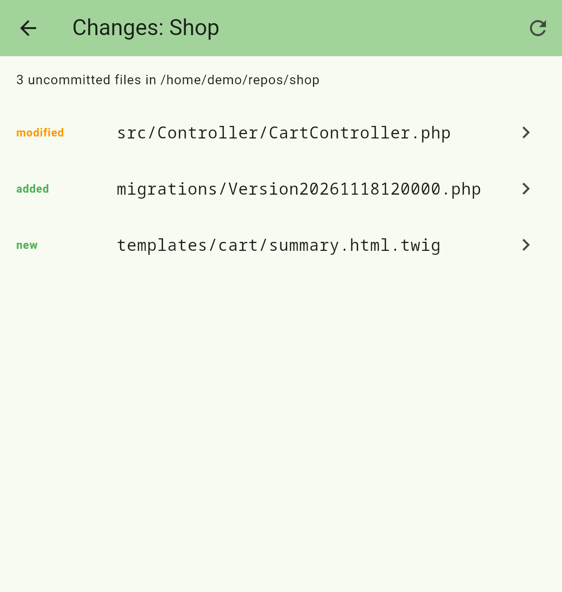
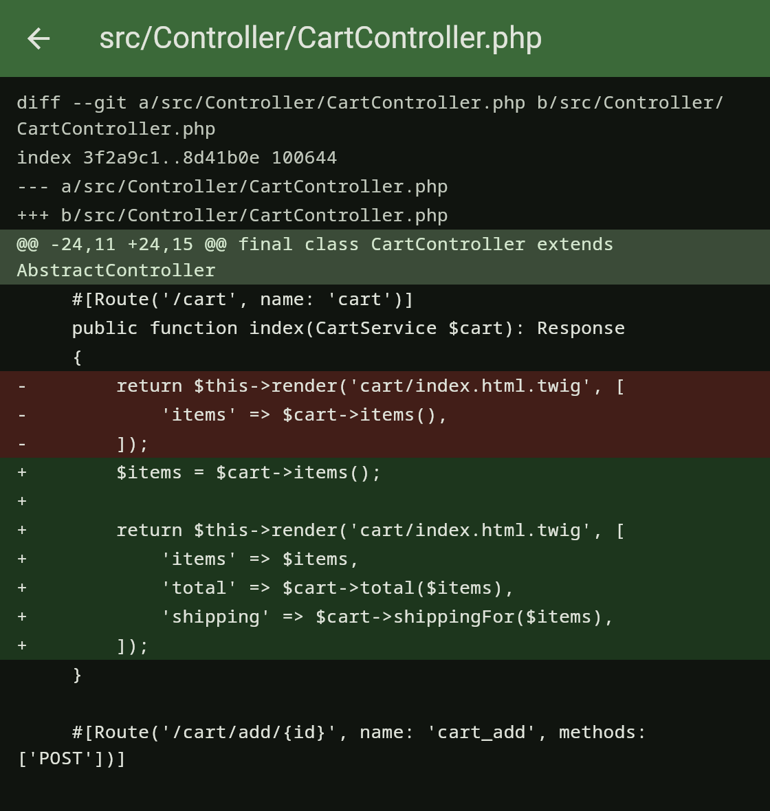
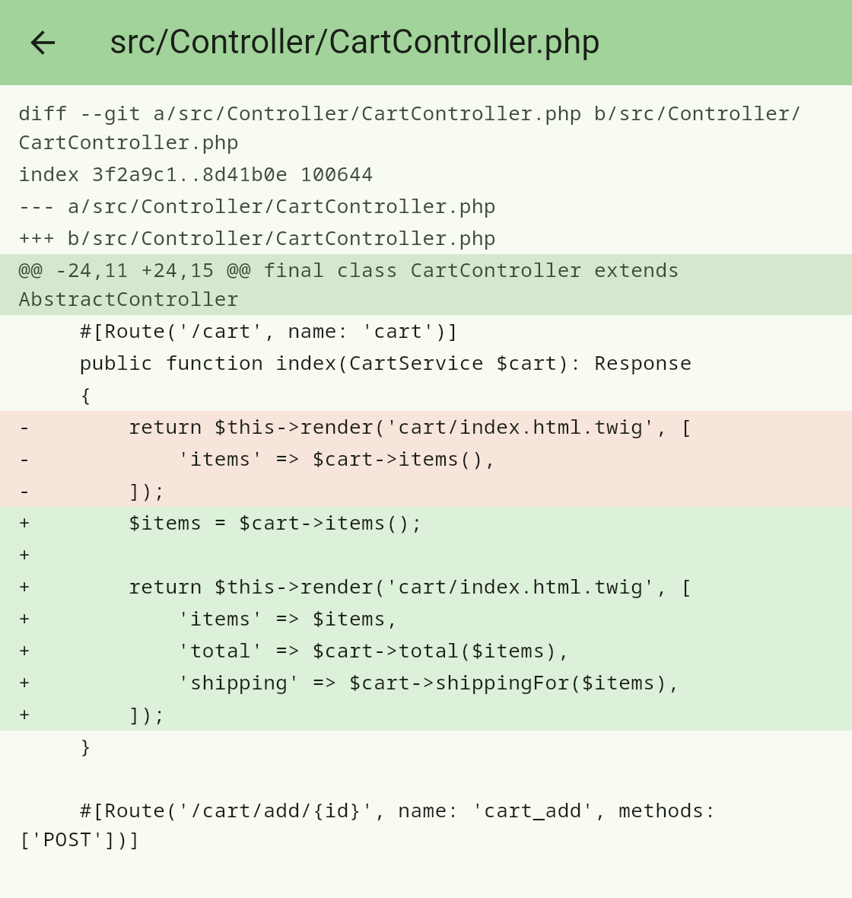

# Uncommitted changes

Tap a site's card, or choose **Changes** in its ⋮ menu, to see the uncommitted files of its
local repository.

{.theme-dark}
{.theme-light}

| State | |
|---|---|
| **modified** | Changed since the last commit. |
| **added** | New and staged (`git add`). |
| **new** | New and not staged yet. |
| **deleted** | Deleted. |
| **renamed** | Renamed or moved; the old path is shown below. |
| **conflict** | A merge conflict. |

Staged and unstaged changes are both shown. The ⟳ button reads the list again.

## The diff

Tap a file to see what changed since the last commit. Removed lines are red, added lines green.
A new file is shown as completely added. The text can be selected and copied.

{.theme-dark}
{.theme-light}
