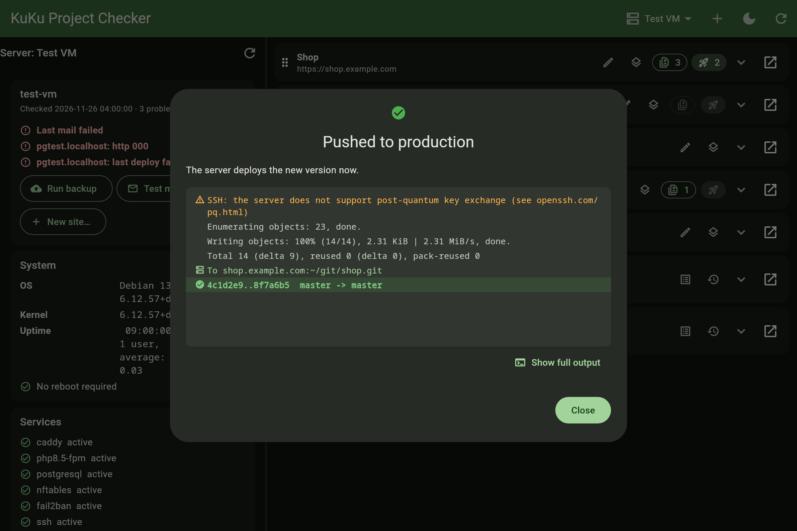

# Deploying

A site whose local repository has a **deploy remote** can be deployed from the app: it pushes the
current branch to that remote, and the server (e.g. Plesk with automatic deployment) deploys the
new version.

Choose the deploy remote in the site's **Edit…** dialog, see [Managing sites](./settings). Left on
**Automatic**, the app picks the first git remote that is not `origin`, not an HTTP(S) address and
not on GitHub, GitLab, Bitbucket or Codeberg, e.g.:

```bash
git remote add production user@server:~/git/shop.git
```

**No deploys** hides deploying for a site, e.g. one that is deployed some other way.

## Deploy

Every site with a local repository has a 🚀 **Deploy** button. When the deploy remote is missing
commits it shows their number; otherwise, or without a deploy remote, it is greyed out.

The app asks first, and says what the push includes:

{.theme-dark}
{.theme-light}

- **Uncommitted files** are not included: only commits are pushed.
- **Commits not pushed to the upstream** (e.g. GitHub) yet are deployed anyway; push them there too.

**Deploy** runs `git push <deploy remote> <branch>` and shows git's output:

{.theme-dark}
{.theme-light}

Afterwards the list is read again, and the site shows `clean, deployed` once everything is deployed.

::: tip SSH passphrase
The app has no terminal, so a graphical program asks for the passphrase of your SSH key:
`ksshaskpass` on KDE, otherwise `ssh-askpass` if it is installed (or whatever `SSH_ASKPASS` points to).
:::

::: info After the push
The app only pushes. Whether the server's deploy script succeeded shows in the server's deploy log,
e.g. in Plesk or with the deploy log page of the
[KuKu system tools bundle](https://github.com/elkuku/SFSystemToolsBundle#readme).
:::
