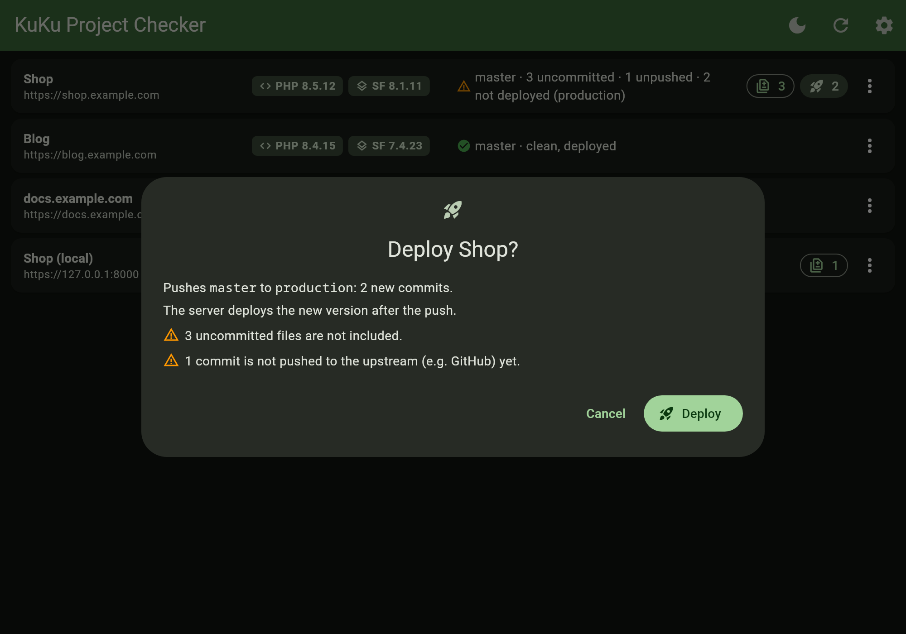
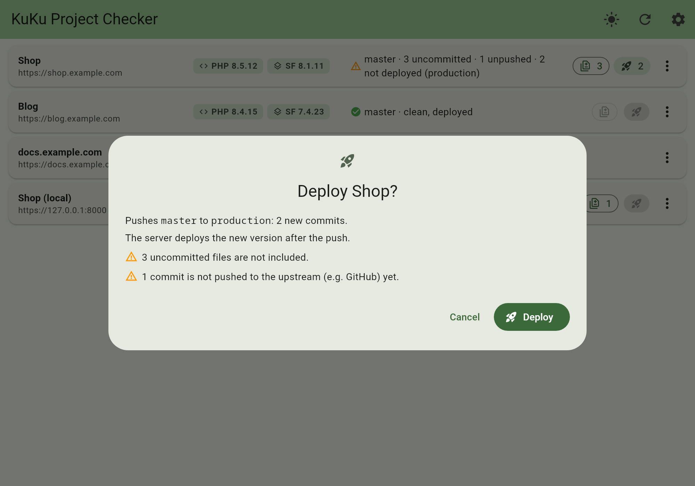
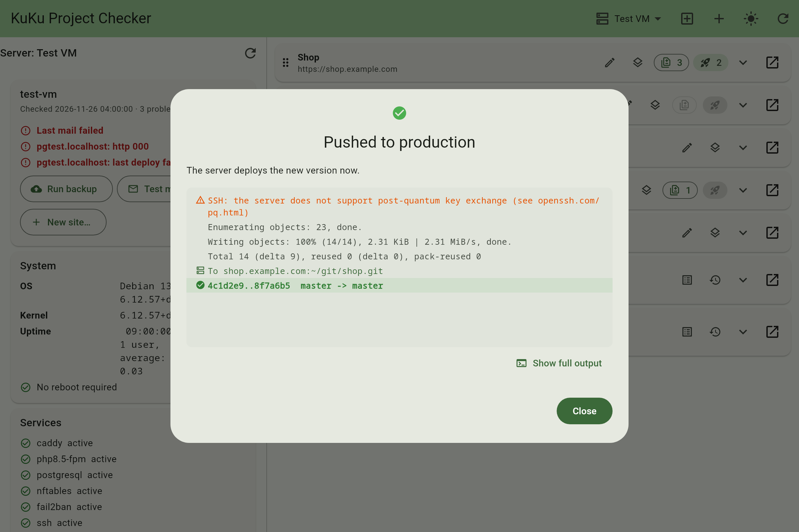

# Deploying

A site whose local repository has a **deploy remote** can be deployed from the app: it pushes the
current branch to that remote, and the server (e.g. Plesk with automatic deployment) deploys the
new version.

Choose the deploy remote in the site's **Edit…** dialog, see [Managing sites](./settings). Left on
**Automatic**, the app picks the first git remote that is not `origin`, not an HTTP(S) address and
not on GitHub, GitLab, Bitbucket or Codeberg, e.g.:

```bash
git remote add production user@server:~/git/shop.git
```

**No deploys** hides deploying for a site, e.g. one that is deployed some other way.

To send **all** sites to one server, e.g. while moving to a new one, use the server switch in
the app bar, see [Servers and new sites](./servers).

## Deploy

Every site with a local repository has a 🚀 **Deploy** button. When the deploy remote is missing
commits it shows their number; otherwise, or without a deploy remote, it is greyed out.

The app asks first, and says what the push includes:

{.theme-dark}
{.theme-light}

- **Uncommitted files** are not included: only commits are pushed.
- **Commits not pushed to the upstream** (e.g. GitHub) yet are deployed anyway; push them there too.

**Deploy** runs `git push <deploy remote> <branch>` and shows git's output:

{.theme-dark}
{.theme-light}

Afterwards the list is read again, and the site shows `clean, deployed` once everything is deployed.

::: tip SSH passphrase
The app has no terminal, so a graphical program asks for the passphrase of your SSH key:
`ksshaskpass` on KDE, otherwise `ssh-askpass` if it is installed (or whatever `SSH_ASKPASS` points to).
:::

## The server's result

Servers that deploy **during** the push and mark their deploy run in the output — like
[KMyServer](https://github.com/elkuku/KMyServer)'s `site-deploy`: `>>>=…` starts the run, `<<<=…`
ends it, `!!!! deploy FAILED` fails it — get a real result:

- **Deployed to …** — the run ended without errors: the new version is live.
- **The deploy failed** — the commits reached the server, but it could not build the new version;
  the previous version stays live. The failing line is marked red in the output.
- **The deploy did not finish** — the run started but its end never came (e.g. the connection
  dropped). Check the site and its deploy log.

The server's steps (`**** Installing composer dependencies…`) are shown as headings.

::: info Other servers
Servers that deploy on their own after the push (e.g. Plesk with a webhook) say nothing about the
deploy in the push: the dialog says **Pushed to …**. Whether the deploy succeeded shows in the
server's deploy log, e.g. in Plesk or with the deploy log page of the
[KuKu system tools bundle](https://github.com/elkuku/SFSystemToolsBundle#readme).
:::

## Roll back

For a site on a KMyServer server (its deploy remote is `<site>@<host>:/srv/sites/<site>/repo.git`),
the site's menu has **Roll back…**. After asking, it runs `site-deploy <site> --rollback` over SSH as
the site user: the live site switches back to the previous release in seconds.

- Only the **code** goes back. The database stays as it is; migrations of the newer release are
  not undone.
- The site reports the rollback as its newest deploy.
- Without an older release the server says `no older release to go back to`.
