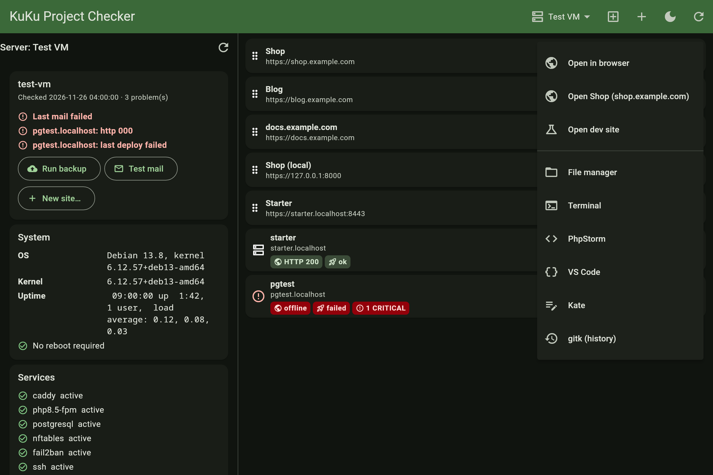
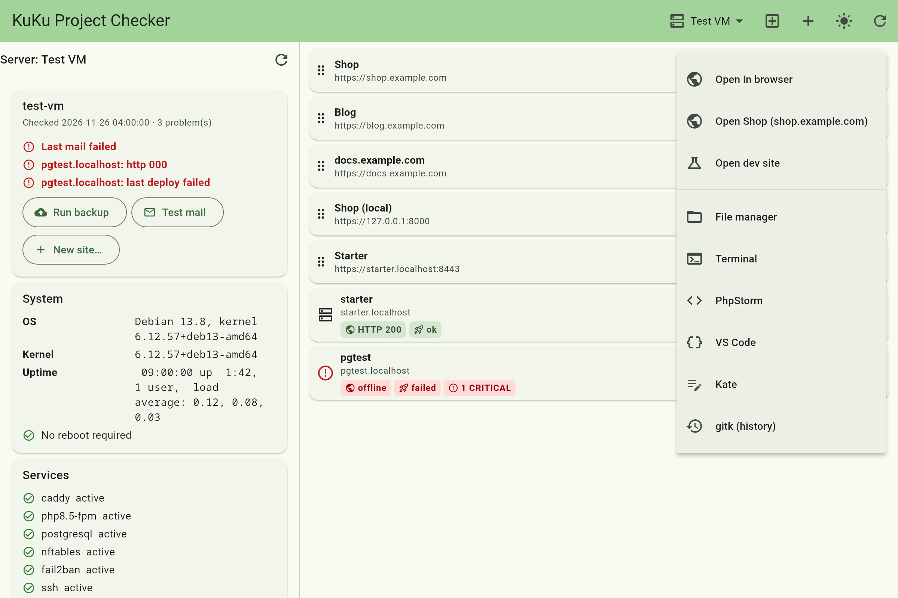

# Open in …

The **Open in…** dropdown of a project contains only open actions. **Edit…**, **Environments…**,
**Remove** and the server actions are buttons on the row, see [Managing sites](./settings). When
the project has several environments, every address gets its own entry.

{.theme-dark}
{.theme-light}

| Entry | Opens |
|---|---|
| **Open in browser** | The project's main site. |
| **Open `<environment>` (`<domain>`)** | Another environment, e.g. `plesk` or a KMyServer target; see [Servers and new sites](./servers). |
| **File manager** | The repository folder (`xdg-open`, e.g. Dolphin). |
| **Terminal** | A terminal in the repository folder: Konsole, GNOME Terminal, Xfce Terminal or kitty. |
| **PhpStorm** | The project in PhpStorm. |
| **VS Code** | The project in VS Code (or VSCodium). |
| **Kate** | The folder in Kate. |
| **gitk (history)** | The history of all branches. |

Only **Open in browser** is shown for a site without a local repository, and only the apps that are installed
are listed.

::: tip PhpStorm from the JetBrains Toolbox
Apps started from the desktop menu don't get your shell's `PATH`. Besides the `PATH`, the app
looks in `~/.local/bin` and `~/.local/share/JetBrains/Toolbox/scripts`, where the Toolbox puts its
`phpstorm` launcher. Enable the shell scripts in the Toolbox settings if PhpStorm is missing.
:::

The apps keep running when you close the checker.
