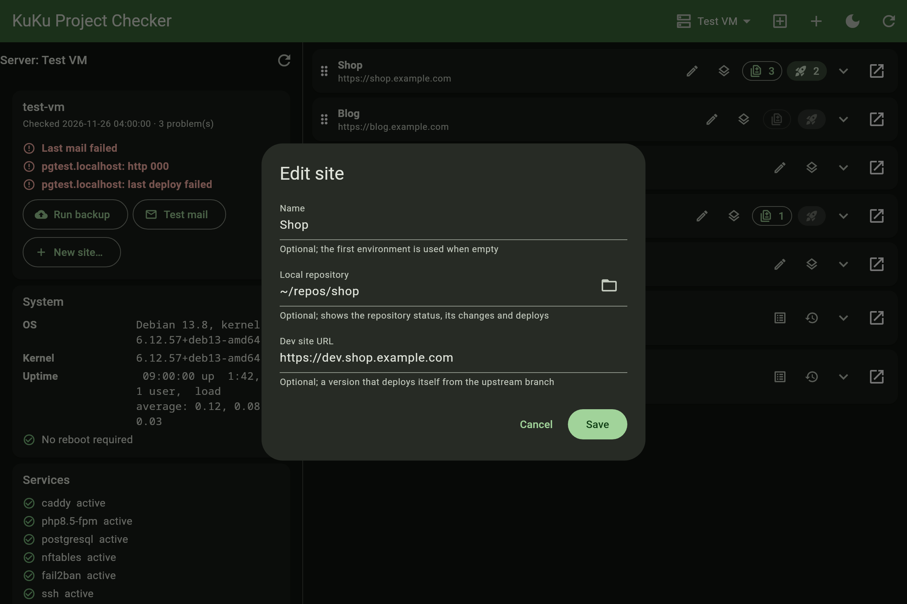
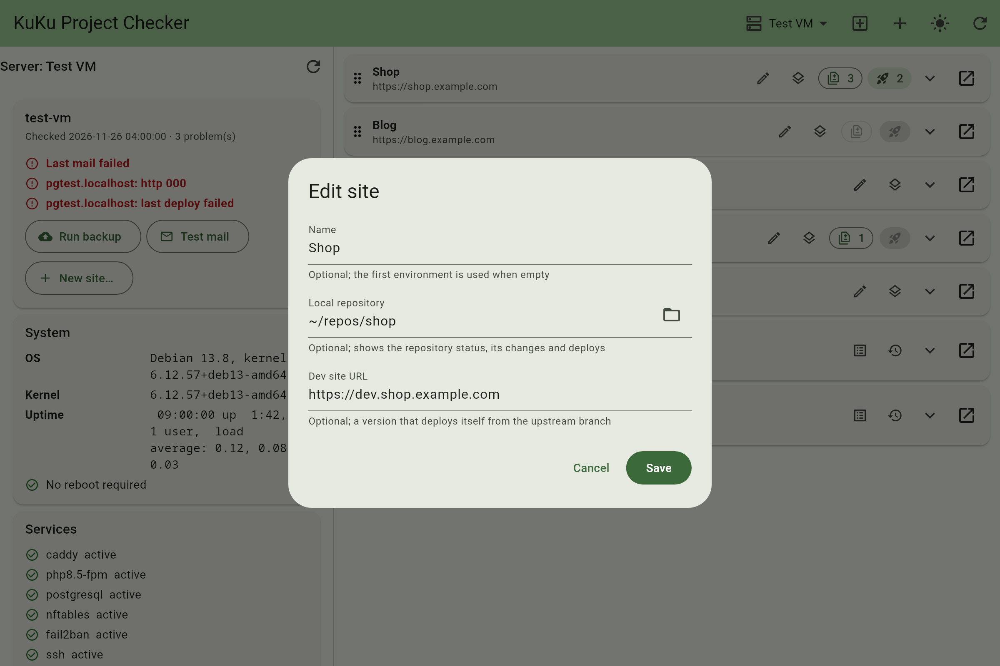

# Managing sites

The sites are managed right in the site list. Each project has:

- **Name** (optional): the title in the site list. Without a name, the name of the first environment
  (or the host of its address) is used.
- **Local repository** (optional): the folder of the project's git repository, e.g. `~/repos/shop`.
  Type it, or choose it with 📂 next to the field; a folder in your home folder is written with `~`.
  With it, the site list shows the repository's status, and the [changes](./changes) and the
  [Open in …](./open-in) apps become available.
- **Dev site URL** (optional): a second version of the site that deploys itself from the code on
  GitHub, e.g. `https://dev.shop.example.com` updated by a webhook on every push to `master`. The
  row then shows how it is doing, and **Open in…** has **Open dev site**.

The address and the [deploy remote](./deploy) belong to the [environments](#environments): the
first environment is the project's main address (used for versions and **Open in browser**).

{.theme-dark}
{.theme-light}

- **Add a site** with ＋ in the top bar (or **Add site** while the list is empty): first the project
  details, then its **first environment** with the address. Nothing is saved before it has one.
- **Edit a project** with the **Edit…** button on its row; this never changes its environments.
- **Remove a site** with **Remove** in the expanded row details; **Undo** in the message at the
  bottom brings it back.
- **Reorder** the sites by dragging them by the handle (⋮⋮) on the left.

## Environments

**Environments…** on a project row gives every version of that project its own name, address,
server and deploy remote: local Symfony, `plesk` in production, one or more KMyServers or VMs.
The **first** environment is the main address shown on the row; new ones are added with
**Add environment**. **Save** stays disabled until at least one environment is present. Older
settings with a single site address are migrated into that first environment.

{.theme-dark}
{.theme-light}

- **Name** — e.g. `plesk`, `vm`; shown in **Open in…**.
- **Server** — the server entry it belongs to (or none for a local site / Plesk with its own
  remote). Servers with a domain suffix suggest a domain for new sites.
- **Address** — the full URL of this environment.
- **Deploy remote** — blank uses the automatic choice, `-` never deploys; see [Deploying](./deploy).

Health reports are matched by server and address (or site name), so the same project can show a
badge for every server it lives on. See [Servers and new sites](./servers).

An environment needs a full address (`https://…`) and a name; the dialog shows what is wrong
otherwise. Every change is saved right away, and only the project you added or edited is read
again.
