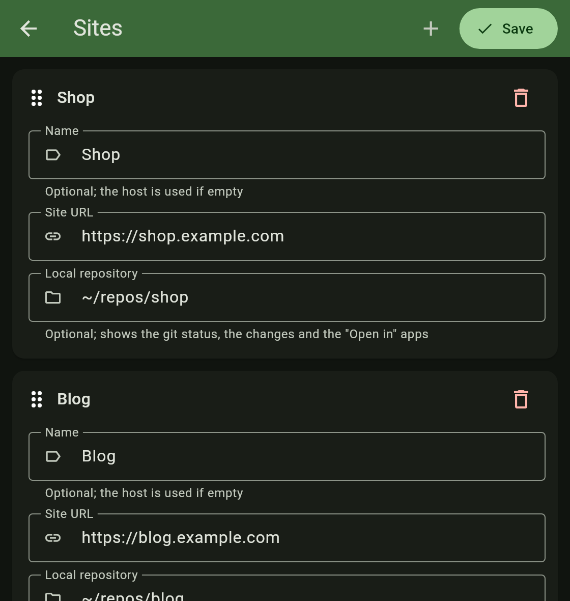

# Managing sites

The gear icon opens the list of sites. Each site has:

- **Name** (optional): the title in the site list. Without a name, the host of the URL is used.
- **Site URL**: the address of the site, e.g. `https://shop.example.com`.
- **Local repository** (optional): the folder of the project's git repository, e.g. `~/repos/shop`.
  With it, the site list shows the repository's status, and the [changes](./changes) and the
  [Open in …](./open-in) apps become available.

{.theme-dark}
{.theme-light}

- **Add a site** with the **+** button.
- **Reorder** the sites by dragging them by the handle (⋮⋮) on the left. The site list uses the same order.
- **Remove** a site with the trash can.
- **Save** keeps the changes. As long as a site has no valid address (`https://…`), Save
  refuses and the address field shows what is wrong.
