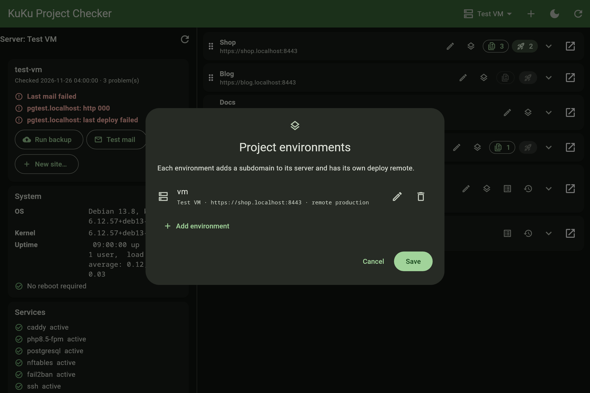
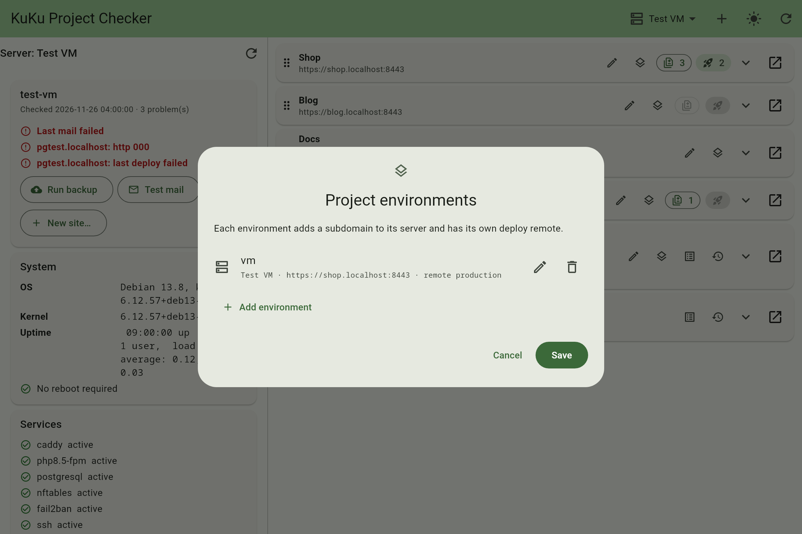

# Managing sites

The sites are managed right in the site list. Each project needs:

- **Display name**: the title in the site list.
- **Local repository**: the folder of the project's git repository, e.g. `~/repos/shop`. Type it,
  or choose it with 📂 next to the field; a folder in your home folder is written with `~`. With it,
  the site list shows the repository's status, and the [changes](./changes) and the
  [Open in …](./open-in) apps become available.
- **GitHub repository**: the full URL of the upstream repository, e.g.
  `https://github.com/elkuku/shop`.

Optional:

- **Dev site URL**: a second version of the site that deploys itself from the code on GitHub,
  e.g. `https://dev.shop.example.com` updated by a webhook on every push to `master`. The row then
  shows how it is doing, and **Open in…** has **Open dev site**.

The address and the [deploy remote](./deploy) belong to the [environments](#environments): the
first environment is the project's main address. An environment on a server stores only its
[subdomain](./servers); the app derives the full URL from that server's base URL. Older settings
that lack a required field still load, but the row marks them **incomplete** and names the missing
fields. In **Edit…** those fields are highlighted; the display name and local repository get a
suggested value derived from the first environment, accepted with the small ✨ button.

The GitHub URL is not guessed: the app asks the installed GitHub CLI (`gh api user/repos`) for all
repositories you can access, including organisation repos, and matches names case-insensitively.
While the lookup runs the field says **Searching GitHub with gh…**; when a similar repository is
found, the status turns green and reads **Existing repo**, with its real URL offered through the ✨
button. Fuzzy matching shares a meaningful word (so `4e-website` finds `website-red`), but ignores
generic words such as `test` and `web`. If several candidates fit, **Choose:** lets you pick the
right one before accepting. A failed lookup is shown in the field. The CLI uses its own login from
the system keyring, so the app stores no GitHub credentials.

{.theme-dark}
{.theme-light}

- **Add a site** with the single ＋ in the top bar (or **Add site** while the list is empty): the
  wizard starts on **Existing project** — enter the project details and its **first environment**
  with the address, all in the same dialog. Nothing is saved before it has one. Switch to
  **New on KMyServer** to create a site on a server instead; see [Servers and new sites](./servers).
- **Edit a project** with the **Edit…** button on its row; this never changes its environments.
- **Remove a site** with **Remove** in the expanded row details; **Undo** in the message at the
  bottom brings it back.
- **Reorder** the sites by dragging them by the handle (⋮⋮) on the left.

## Environments

**Environments…** on a project row gives every version of that project its own name, address,
server and deploy remote: local Symfony, `plesk` in production, one or more KMyServers or VMs.
The **first** environment is the main address shown on the row; new ones are added with
**Add environment**. **Save** stays disabled until at least one environment is present. Older
settings with a single site address are migrated into that first environment.

{.theme-dark}
{.theme-light}

- **Name** — e.g. `plesk`, `vm`; shown in **Open in…**.
- **Server** — the server entry it belongs to (or none for a local site with its own remote).
- **Subdomain** — e.g. `shop` or `dev-shop`. With a server, the environment's address is derived
  from that server's base URL; without one, enter the full address (`https://…`) instead.
- **Deploy remote** — blank uses the automatic choice, `-` never deploys; see [Deploying](./deploy).

Health reports are matched by server and subdomain (or site name), so the same project can show a
badge for every server it lives on. See [Servers and new sites](./servers).

An environment needs a name and either a valid subdomain or a full `https://` address; the dialog
shows what is wrong otherwise. Every change is saved right away, and only the project you added or
edited is read again.
