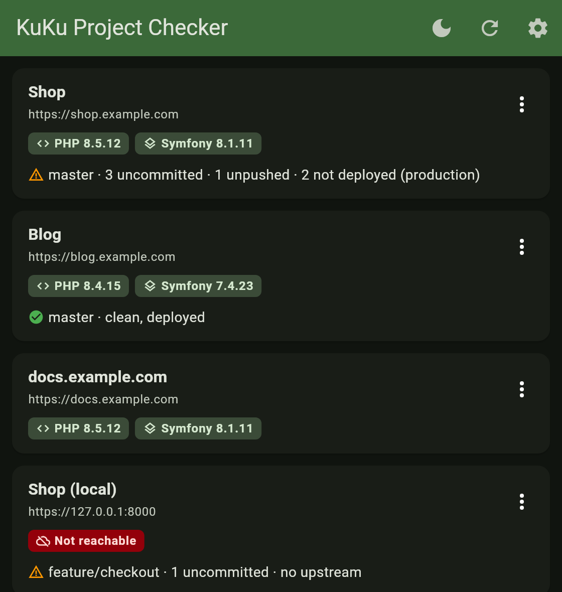

# The site list

Each site is a card with its name, its address, its versions and, if a local repository is set,
the state of that repository.

## Versions

- **PHP** and **Symfony**: the versions the site reports, see [Site requirements](./site-requirements).
- **Not reachable**: the site didn't answer, or it has no `/system/info/` endpoint.

## Repository status

The line at the bottom shows the branch of the local repository and what is pending:

| Shown | Meaning |
|---|---|
| ✅ `clean, deployed` | Everything is committed, pushed and deployed. |
| ✅ `clean` | Everything is committed and pushed; the repository has no deploy remote. |
| `3 uncommitted` | Modified, new or deleted files. Tap the card to see them, see [Uncommitted changes](./changes). |
| `1 unpushed` | Commits that are not on the upstream branch yet (e.g. GitHub). |
| `2 not deployed (production)` | Commits that are not on the deploy remote yet. |
| `no upstream` | The branch doesn't track a remote branch. |
| `not on production` | The branch was never pushed to the deploy remote. |

The **deploy remote** is the first remote that is not `origin` and not an HTTP(S) address,
e.g. a Plesk or Dokku git remote.

::: info Nothing is fetched
The app never contacts the remotes, so it never asks for an SSH passphrase. "Unpushed" and
"not deployed" compare with what this machine fetched or pushed last. A push from another machine
shows only after a `git fetch`.
:::

## The app bar

| Icon | |
|---|---|
| ☀️ 🌙 Ⓐ | The theme: light, dark or following the system. Each click switches to the next one. |
| ⟳ | Reads all versions and repositories again. |
| ⚙ | The settings, see [Managing sites](./settings). |

