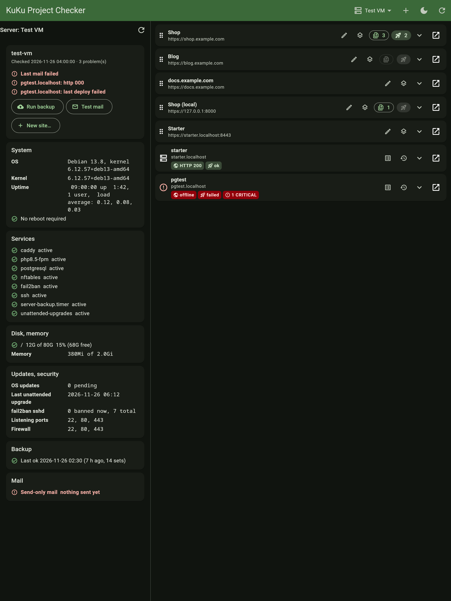
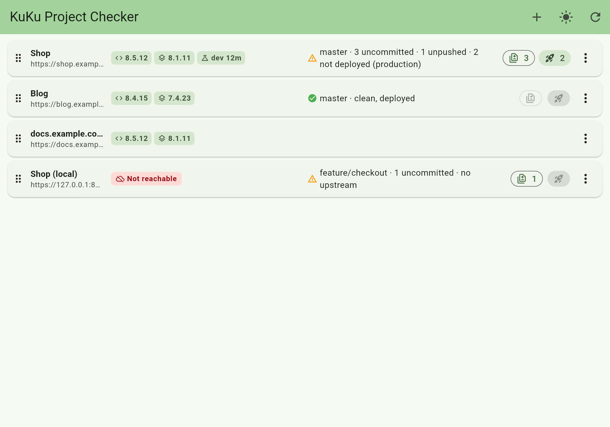

# The site list

Each site is a card with its name, its address, its versions and, if a local repository is set,
the state of that repository.

{.theme-dark}
{.theme-light}

## Versions

- **PHP** and **Symfony**: the versions the site reports, see [Site requirements](./site-requirements).
- **Database** (🗄 MariaDB 12.3.4): the database server, if the site tells it.
- **Last deploy** (🚀 3h ago): when the site was last deployed, if it tells it. Orange if that deploy
  finished with errors, red if it didn't finish. Hover for the date.
- **Not reachable**: the site didn't answer, or it has no `/system/info/` endpoint.

### Live and local versions

If a site has a local repository, the app compares its versions with the ones the project uses on
this machine. A badge that differs turns **orange** with ⇄; hover over it to see both versions.

| Badge | Local version from | Compared |
|---|---|---|
| PHP | the `php` on your PATH | major and minor, e.g. 8.5 |
| Symfony | `symfony/http-kernel` in `composer.lock` | the full version, so an update that is not deployed yet shows |
| Database | the database image in the docker compose files, e.g. `mariadb:12.3` or `postgres:16-alpine` | the platform, and the version as far as the image tag gives it: `16` matches 16.4 |

The Symfony project doesn't have to be at the top of the repository: if the repository has no
`composer.json`, the app uses the first folder directly inside it that has one, e.g. `web/` in a
repository that also holds an Android app. The compose files are read from both places.

## Repository status

The line at the bottom shows the branch of the local repository and what is pending:

| Shown | Meaning |
|---|---|
| ✅ `clean, deployed` | Everything is committed, pushed and deployed. |
| ✅ `clean` | Everything is committed and pushed; the repository has no deploy remote. |
| `3 uncommitted` | Modified, new or deleted files. Tap the card to see them, see [Uncommitted changes](./changes). |
| `1 unpushed` | Commits that are not on the upstream branch yet (e.g. GitHub). |
| `2 not deployed (production)` | Commits that are not on the deploy remote yet. |
| `no upstream` | The branch doesn't track a remote branch. |
| `not on production` | The branch was never pushed to the deploy remote. |

The **deploy remote** is the one chosen for the site in its **Edit…** dialog; on **Automatic**,
the first remote that is not `origin`, not an HTTP(S) address and not on a code host like GitHub,
e.g. a Plesk or Dokku git remote. See [Deploying](./deploy).

## Each site

- **⋮⋮** on the left: drag the site to another place in the list.
- **⋮** on the right: **Edit…** and **Remove** the site, and open it in the browser or the
  repository in other apps, see [Managing sites](./settings) and [Open in …](./open-in).

## Buttons

Every site with a local repository has two buttons. They show the number of files or commits
pending, and are greyed out when there is nothing to do:

- **Changes** (📄 3): the uncommitted files, see [Uncommitted changes](./changes).
- **Deploy** (🚀 2): pushes the commits to the deploy remote, see [Deploying](./deploy).

In a wide window each site is one compact row and the buttons show only the icon and the number;
hover over them for what they do. In a narrow window the site is a card with labeled buttons.

::: info Nothing is fetched
The app never contacts the remotes, so it never asks for an SSH passphrase. "Unpushed" and
"not deployed" compare with what this machine fetched or pushed last. A push from another machine
shows only after a `git fetch`.
:::

## The app bar

| Icon | |
|---|---|
| ＋ | Adds a site, see [Managing sites](./settings). |
| ☀️ 🌙 Ⓐ | The theme: light, dark or following the system. Each click switches to the next one. |
| ⟳ | Reads all versions and repositories again. |

::: tip
The screenshots in this documentation follow its theme: switch it with the toggle at the top.
:::
